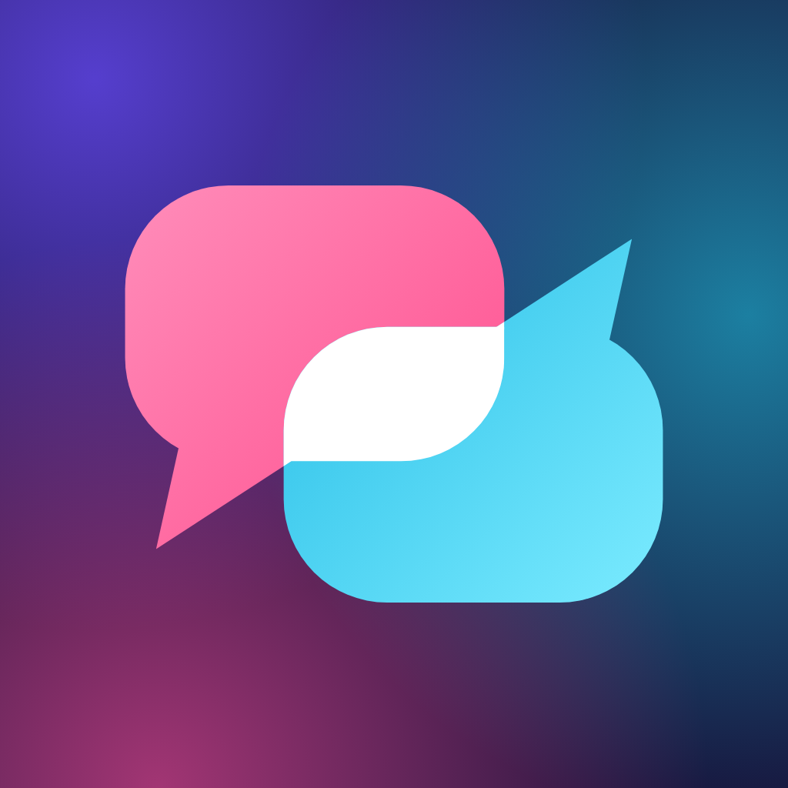

<p align="center">
  
</p>

<h1 align="center">iTrans</h1>

<p align="center">面对面说话就能翻译的 iOS App，支持 iPhone、iPhone Duo 和 iPad。</p>

---

## 这是什么

iTrans 是一个以「两个人对话」为中心的翻译 App。手机放在两人中间，屏幕上下各半，各说各的语言，对方那一半直接显示并朗读译文。

- 语言：SwiftUI，最低支持 iOS 18
- 当前版本：0.1.0
- 界面语言：简体中文和英文，跟随系统

## 主要功能

| 功能 | 说明 |
|---|---|
| 面对面翻译 | 屏幕上下分屏，按住或轻点麦克风说话，松手出译文并朗读 |
| 对话流 | 整场对话以气泡显示，可重播、复制、修正原文后重译、删除、分享 |
| 打字输入 | 不方便说话时打字，可选发送后是否朗读译文 |
| 只听不说 | 持续听对方说话，只显示译文，全程不出声 |
| 大字展示 | 译文铺满屏幕给对方看 |
| 拍照和图片翻译 | 识别图片里的文字，逐行翻译，可放进对话 |
| 常用短语 | 收藏常说的话，点一下就翻译并朗读 |
| 历史记录 | 对话存在本机，可搜索、收藏、接着聊 |
| 离线可用 | 用系统自带的翻译，下载语言包后不联网也能用 |
| 折叠屏适配 | 外屏、展开、半开三种状态各有专门布局 |

## 隐私

- 翻译在手机上完成；语音识别优先在手机上完成。
- 对话历史只存在本机，不上传。
- App 不连接任何自建服务器。

## 目录

```
app/                 App 工程
  XTrans/            源代码
    App/             入口、调试启动参数
    Core/            识别、翻译、朗读、历史等核心逻辑
    Features/        各个界面（面对面、对话流、历史、设置等）
    Theme/           颜色、字体、玻璃材质等设计规范
  XTransTests/       单元测试（233 个）
  Config/            构建配置
  project.yml        工程定义（用 XcodeGen 生成 Xcode 工程）
design-options/      早期设计方案对比
```

工程内部名是 XTrans，对外显示名是 iTrans。

## 构建和运行

需要 Xcode 26 或更新版本，以及 [XcodeGen](https://github.com/yonaskolb/XcodeGen)。

```bash
cd app
xcodegen generate
open XTrans.xcodeproj
```

跑单元测试：

```bash
xcodebuild -project XTrans.xcodeproj -scheme XTrans \
  -destination 'platform=iOS Simulator,name=iPhone 17 Pro Max' test
```

真机运行需要在 Xcode 里给 `XTrans` 选择自己的开发者团队，并把 `app/project.yml` 里的包名 `com.example.itrans` 换成你自己的。


## 已知限制

- 系统翻译和麦克风在模拟器上不可用，语音和本地翻译要在真机上测试。
- 离线语言包的下载由系统界面完成，App 内看不到进度。
- 相机实时翻译（译文叠在取景画面上）还没做，目前是拍完再选文字。

## 更多资料

更细的工程说明和调试启动参数见 [app/README.md](app/README.md)。
